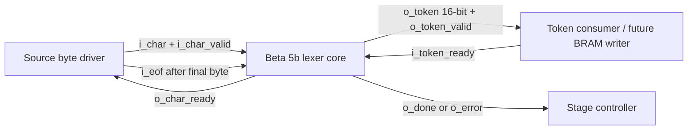
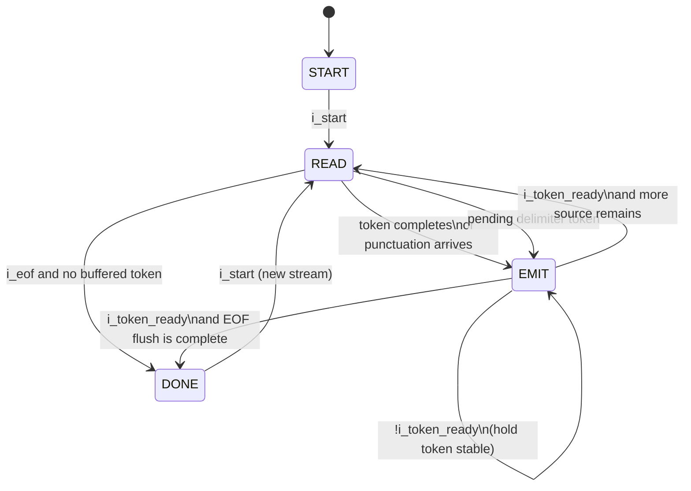
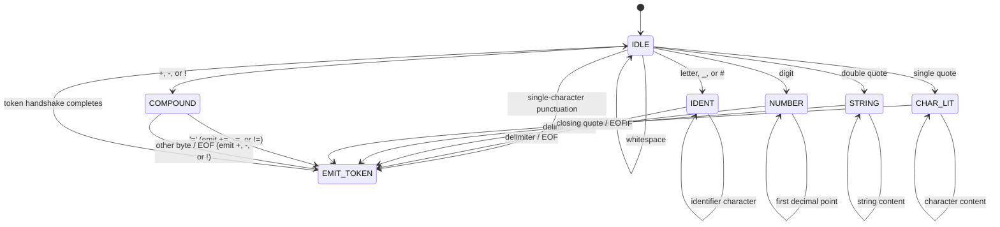

# Beta 5b Lexer State Machines

This document describes the canonical Beta 5c `rtl/lexer_engine.sv` interface. Legacy lexer variants with obsolete port contracts are intentionally excluded from this standalone repository.

## Stream contract

```text
Source byte transfer:  i_char_valid && o_char_ready
Token word transfer:   o_token_valid && i_token_ready
```

The source must keep a byte stable while `i_char_valid=1` until `o_char_ready=1`. The token consumer must keep `i_token_ready=1` or the lexer holds the same token word valid until it is accepted. `i_eof` is asserted after the final byte has been processed; it flushes a buffered identifier, number, string, character literal, or unfinished single-character compound prefix, then raises `o_done` after the final token is accepted.



## Top-level token-emission FSM



## Read-mode lexer behavior



When a byte closes a buffered word-for example, the `(` in `d(`-the lexer emits the word, saves the already-accepted boundary byte in `replay_char`, and processes it internally after the output handshake. The same replay mechanism handles a non-`=` lookahead after `+`, `-`, or `!`, and adjacent token starts such as an identifier followed immediately by a quote. `o_char_ready` stays low until the replay byte has been consumed.

The lexer has a shared 32-byte scratch buffer. On overflow, it raises sticky `o_error`, drops extra buffered text, and continues scanning. Integers also update an independent 8-bit decimal accumulator, so their hardware payload wraps deterministically modulo 256 even if the digit string exceeds 32 bytes. The C++ reference uses signed `int`; overflow there is undefined, so very long integers are not a portable cross-language comparison. String contents do not appear in the current token word, and multi-character identifiers/character literals use payload `FF`, so retaining the full text is not needed for those token encodings.

## Token word encoding

```text
[15:8] token type from rtl/lexer_pkg.sv / reference/tokens.hpp
[7:0]  payload: ASCII for one-character IDENT/CHAR, low byte for INT, otherwise FF
```

For the C++ `add_func.c` fixture, the first four words are:

```text
15ff  INT_WORD
1d64  IDENT('d')
01ff  LPAREN
15ff  INT_WORD
```
